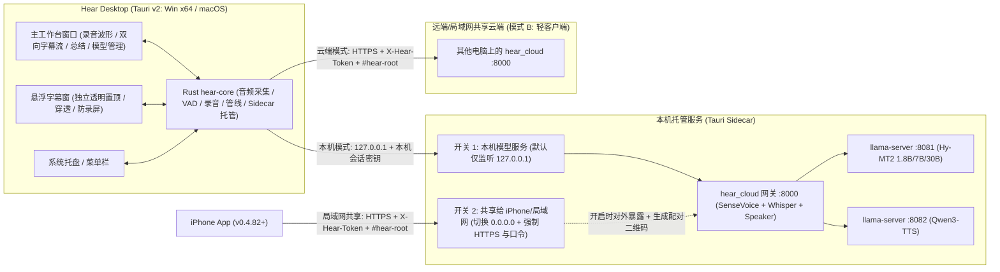
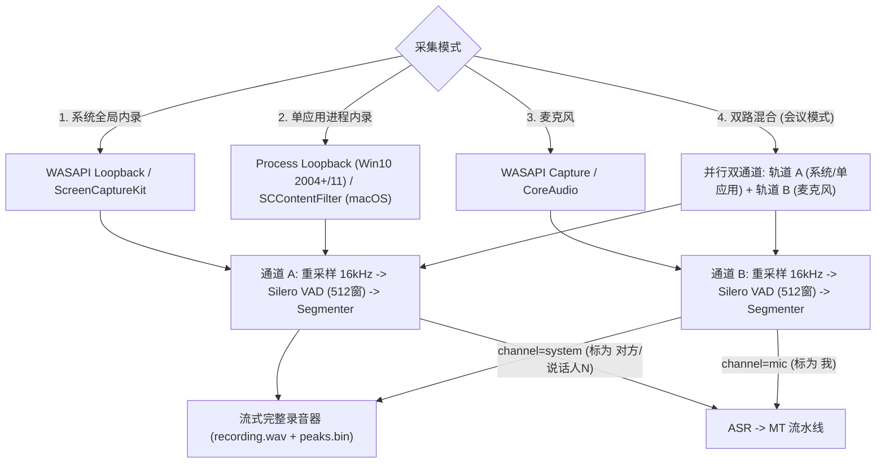

# 听见（Hear）桌面端（Windows x64 / 后续 macOS）详细工程设计方案（v2.0 定稿）

> **设计结论确认**：
> - **核心形态**：去掉手机端「双人对话模式」与「历史会话列表」，升级为**「完整录音 + 时间轴双向联动 + 悬浮字幕 + 一键总结」**的桌面端实时翻译工作台。
> - **技术栈**：**Tauri v2（Rust `hear-core` + React/TypeScript/Tailwind）**，低内存占用，Windows x64 首发并预留 ~85–90% 代码复用给后续 macOS 版本。
> - **服务模式**：支持**本机托管现有 `server/`（Tauri Sidecar 附带程序）**与**连接远端/局域网云端服务**双模；本机模式下将**「仅本机使用」**与**「局域网共享给 iPhone」**拆分为两个明确开关（默认仅 `127.0.0.1`，开启共享时强制启用 HTTPS 证书 + 访问口令）。
> - **功能范围**：全量纳入悬浮字幕、系统/单应用/麦克风/双路混合内录、完整录音双向定位、本地音视频拖入转字幕、可选朗读/克隆与原音压低、全局快捷键与托盘、`.srt`/`.md` 导出与 LLM 纪要总结。

---

## 一、系统总体架构

### 1.1 多端协同与「仅本机 / 局域网共享」双开关拓扑



**双开关安全边界设计（核心约束）**：

| 状态 | 开关 1：本机模型服务 | 开关 2：共享给 iPhone / 局域网 | 监听地址 | 鉴权与传输策略 |
| --- | :---: | :---: | --- | --- |
| **纯云端轻客户端** | 关 | 关（不可选） | 不启动本地服务 | 桌面端作为纯客户端直连远端 `hear_cloud`（与 iOS 同套严格模式 `#hear-root=...` + `X-Hear-Token`） |
| **默认本机使用** | **开** | 关 | `127.0.0.1:8000`（`8081/8082` 亦仅 `127.0.0.1`） | 仅本机回环可访问；桌面端每次启动生成随机临时 `HEAR_LOCAL_SECRET` 通过环境变量/stdin 注入 Sidecar，防本机其他进程盗用；无需配置防火墙 |
| **一机两用（共享给手机）** | **开** | **开** | `0.0.0.0:8000`（`8081/8082` 保持 `127.0.0.1` 不外露） | **强制开启 HTTPS（自签根证书）+ 访问口令（单口令或托管 Token）**，界面展示局域网地址、`#hear-root=...` 专有配对二维码与防火墙状态；关闭开关时立即收敛回 `127.0.0.1` |

---

## 二、仓库目录与代码复用结构（面向 Win x64 + macOS）

建议直接放在当前仓库新增的 `desktop/` 目录下，与 `Hear/`（iOS）、`server/`（Python 服务）平级，确保三端共享协议文档、模型清单与 CI：

```text
Hear/
├── Hear/                         # 现有 iOS 客户端 (Swift/SwiftUI)
├── server/                       # 现有共享模型网关与鉴权服务 (Python)
├── desktop/                      # 新增：跨平台桌面端 (Tauri v2)
│   ├── src/                      # React + TypeScript + Tailwind UI (Win/Mac 100% 共享)
│   │   ├── windows/
│   │   │   ├── main/             # 主工作台：录音波形播放器、双向字幕流、LLM 总结、文件拖入、设置与模型管理
│   │   │   └── subtitle/         # 独立悬浮字幕窗：双语/仅译文、悬停工具条、样式渲染
│   │   ├── stores/               # Zustand 轻状态（分离高频字幕流与低频设置，彻底避免全树重绘）
│   │   └── lib/                  # Tauri invoke/event 封装、SRT/VTT/MD 导出器、时间轴二分检索
│   └── src-tauri/                # Rust 核心层 (hear-core + Tauri 宿主)
│       ├── Cargo.toml
│       ├── tauri.conf.json       # 多窗口配置 + externalBin Sidecar + 托盘 + 全局快捷键
│       ├── binaries/             # Tauri externalBin 附带程序（按 target triple 命名，CI 自动构建打包）
│       └── src/
│           ├── main.rs           # Tauri 启动、窗口管理、托盘、全局快捷键注册
│           ├── state.rs          # 显式单向状态机 (Idle / Recording / Playing / BatchProcessing)
│           ├── audio/            # 音频管线：重采样、环形缓冲、双路混音与分轨
│           ├── vad/              # 本机 Silero VAD (ort / ONNX Runtime，严格 512 采样对齐) + Segmenter
│           ├── recorder/         # 完整录音流式落盘 (WAV/双轨) + 波形峰值生成 + Seek 播放引擎
│           ├── pipeline/         # 预览 ASR/MT、正式 ASR/Whisper 校正/MT、语音过滤、术语表、上下文
│           ├── tts/              # 可选朗读与 Qwen3-TTS 克隆队列 + 指定输出设备 + 原音压低 (Ducking)
│           ├── batch/            # 本地音视频文件解码 (symphonia / ffmpeg) 批量转译生成双语字幕
│           ├── cloud/            # HearCloudClient (TLS 指纹固定、Token、重试截止时间、SSE 流式翻译)
│           ├── llm/              # 摘要客户端 (OpenAI/Anthropic/本地兼容，支持 SSE 流式与时间戳锚点)
│           ├── sidecar/          # 托管 server/ 生命周期 (启动/探活/优雅关闭/防僵尸进程/双开关切换)
│           └── platform/         # 平台抽象 Trait（仅 ~10% 平台差异代码）
│               ├── mod.rs        # AudioCaptureTrait / OverlayWindowTrait / AudioDuckingTrait / HardwareProbe
│               ├── windows.rs    # WASAPI Loopback & Process Loopback、Win32 穿透/WDA_EXCLUDEFROMCAPTURE、Job Object、ISimpleAudioVolume
│               └── macos.rs      # (后续 Phase 3) ScreenCaptureKit、NSWindow 穿透/sharingType=.none、CoreAudio
└── .github/workflows/
    └── build-desktop.yml         # 新增：Windows x64 (.exe/.msi) 与后续 macOS (.dmg) 自动打包流水线
```

---

## 三、核心模块详细设计

### 3.1 模块 A：完整录音模式与「音频 ↔ 原文/译文」双向联动

去掉 iOS 的对话模式和历史会话列表后，桌面端主工作台围绕**“当前完整录音 + 同步字幕流 + 一键总结”**展开：

#### 1. 数据流与时间轴模型
- **流式完整录音（防崩溃不丢数据）**：
  - 按下开始后，音频采集线程将原始音频流式写入工作区临时文件 `recording.wav`（16kHz 或 48kHz PCM，每 2 秒刷新 RIFF 头长度，即使断电/崩溃已录内容仍完整可读）。
  - 在**双路混合模式（系统声 + 麦克风）**下，录制为**立体声双轨**（左声道 = 系统声/远端，右声道 = 麦克风/我；播放时可混音单声道听，或让用户分别调节远端/本机音量），同时两路各自跑独立 VAD，零回声串扰！
  - 同步在后台以每 50ms 采样窗计算振幅峰值数组 `peaks.bin`，供前端 Canvas 零卡顿渲染完整波形进度条。
- **字幕段落结构（精确绑定录音时间轴）**：
  ```ts
  interface SubtitleSegment {
    id: string;
    seq: number;
    startMs: number;          // 相对于本段完整录音 0ms 的起点（精确到毫秒）
    endMs: number;            // 段落终点
    channel: "system" | "mic" | "file";
    speakerLabel?: string;    // 如 "对方" / "我" / "说话人 1"（可编辑）
    sourceLang: string;
    targetLang: string;
    sourceText: string;
    translatedText: string;
    baselineTranslated?: string; // Whisper 校正前的初版译文，用于高亮修订差异
    status: "preview" | "final" | "correcting" | "error";
    isEdited?: boolean;
  }
  ```

#### 2. 双向精准联动机制
- **音频驱动文字（听录音看原文+译文）**：
  - 底部内置专业录音播放器：播放/暂停、波形进度条拖拽、快退/快进 5 秒、倍速（`0.75x / 1.0x / 1.25x / 1.5x / 2.0x`）、音量、可选“回放时同步推到悬浮字幕窗”。
  - Rust 播放引擎以 30Hz 推送当前 `playbackMs`；前端用二分查找定位 `startMs <= playbackMs <= endMs` 的活跃句，高亮该句并平滑滚动到可视区中央；若用户正在手动上翻浏览其他段落，自动暂停跟随并显示「回到当前播放位置」悬浮按钮。
- **文字驱动音频（点选原文+译文跳转录音）**：
  - 点击字幕流中任意一句的原文或译文，立即调用 `player_seek(segment.startMs)` 并定位/播放该段录音（支持设置开关：「点击仅跳转」或「点击跳转并从此处播放」，以及单句 A-B 复读按钮）。
  - 双击/右键仍支持**修改原文并重新翻译**（保留 iOS 好用能力），不改动该句的时间戳。
- **一键总结与时间戳反链**：
  - 保留并强化 iOS 现有的多模板一键总结（会议纪要、双语对照要点、行动项等，支持 OpenAI / Anthropic / 本机模型 + SSE 流式输出）。
  - 提示词要求模型在关键结论后附带来源时间戳（如 `[04:18]`）；前端渲染 Markdown 摘要时自动将 `[mm:ss]` 解析为可点击胶囊——**点击纪要里的任意时间点，直接跳到录音对应位置和字幕句**！
- **无“历史会话列表”但支持文件级存取**：
  - 应用内不维护复杂的聊天记录库；当前工作台只聚焦“当前这一份录音”。
  - 提供顶栏按钮：**「新建/清空」**、**「保存记录包（`.hearrec` 或目录：含音频 + `transcript.json` + `summary.md`）」**、**「打开已有记录」**，以及一键导出 **`.srt` / `.vtt` / `.md` / `.txt` / `.wav`**。

---

### 3.2 模块 B：悬浮字幕窗（Floating Subtitles）

作为独立 Tauri 窗口（`label: "subtitle"`），由主进程通过高频轻量事件 `subtitle:frame` 驱动（只传最近 1–4 句可见文本与状态，杜绝整列表重绘）：

1. **原生窗口属性（Win x64 / macOS 对齐）**：
   - 无边框、透明背景、置顶（`always_on_top(true)`）、不出现在任务栏（`skip_taskbar(true)`）、多显示器坐标与缩放比记忆。
   - **鼠标穿透锁定**：
     - Windows：`SetWindowLongPtrW(hwnd, GWL_EXSTYLE, ex_style | WS_EX_TRANSPARENT | WS_EX_LAYERED)`
     - macOS：`ns_window.setIgnoresMouseEvents(true)`
     - 解锁方式：全局快捷键 `Ctrl+Shift+L` 或点击系统托盘菜单。
   - **防共享 / 防录屏隐私开关**：
     - Windows：`SetWindowDisplayAffinity(hwnd, WDA_EXCLUDEFROMCAPTURE)`（Zoom/Teams/腾讯会议/OBS 捕获画面中字幕自动隐身，本机屏幕正常可见）
     - macOS：`ns_window.setSharingType(.none)`
2. **显示形态与视觉体验**：
   - 排版切换：双语（原文上/译文下）、译文优先（译文大字/原文小字弱化）、仅译文、简/繁中文显示。
   - 视觉参数：字号 `14–48px`、最大显示行数 `1–4`、背景透明度 `0–90%`、文字描边/阴影开关、静默自动淡出（如 15 秒无新语音半透明收缩）。
   - **悬停迷你控制条**（未锁定时鼠标移入显现）：开始/暂停录音、双语/仅译文、音频源快速切换、锁定穿透、复制最近一句、唤出主工作台。

---

### 3.3 模块 C：多源音频采集、单应用内录与双路混合



- **单应用进程内录（Windows x64 关键实现）**：
  - 使用 Windows 10 2004 (Build 19041) / Windows 11 原生 `ActivateAudioInterfaceAsync` + `AUDIOCLIENT_PROCESS_LOOPBACK_PARAMS`（`PROCESS_LOOPBACK_MODE_INCLUDE_TARGET_PROCESS_TREE`）。
  - UI 下拉框自动枚举当前正在发声或打开窗口的应用（带图标与进程名，如 Chrome、Edge、Zoom、Teams、腾讯会议、PotPlayer、VLC），选中后**自动包含该进程树**（完美适配 Chrome/Electron 多子进程架构），彻底屏蔽系统提示音与微信消息音！
  - 在更老版本 Windows 上自动优雅降级为系统全局 Loopback 并给出提示。
- **双路混合 + 固定源语种选项**：
  - 会议场景开双路混合：轨道 A（系统声）自动标「对方」（开启说话人区分时进一步细分为「对方 1 / 对方 2」），轨道 B（麦克风）自动标「我」。
  - 看外语视频/网课可勾选**「锁定源语种（如仅 English → 中文）」**，跳过自动语种判定，大幅减少中英夹杂误判并降低首字延迟。
- **断句与 VAD 沿用并优化 iOS `0.4.82` 经验**：
  - Silero VAD ONNX 运行在 Rust 独立线程，严格 512 采样（32ms）输入，彻底消除 480 vs 512 相位漂移。
  - `Segmenter` 使用环形缓冲（`VecDeque`）零搬移，保留 0.4.80 已验证的长段找停顿切分与无漏样边界。

---

### 3.4 模块 D：可选朗读 / 声音克隆与输出分流（防回环 + 原音压低）

- **默认状态**：桌面端默认**关闭自动朗读**（看视频/开会以悬浮字幕为主，不打扰原声）；需要“同声传译听译”时一键开启。
- **防回环机制（关键避坑！）**：
  - 如果正在录制**系统全局声音**同时本机又播放译文朗读，必须防止自己的朗读声被重新录回造成死循环！
  - **两道防线**：
    1. Windows 10 2004+/11 默认对系统内录采用 `PROCESS_LOOPBACK_MODE_EXCLUDE_TARGET_PROCESS_TREE` 排除 `HearDesktop.exe` 自身进程树音频（从系统内核层彻底不录自己的播报声！）；
    2. 同时支持在设置中**指定独立朗读输出设备**（例如系统声在音响/主耳机，朗读输出到副耳机/蓝牙耳机）。
- **原音压低（Audio Ducking）**：
  - 朗读/克隆语音开始播放时，通过 Windows `IAudioSessionManager2` / `ISimpleAudioVolume` 将目标被翻译应用（或非 Hear 的其他会话）音量平滑压低至可配置比例（默认 25%），播完后 300ms 平滑恢复 100%。
- **朗读引擎**：优先支持本机/云端 Qwen3-TTS 声音克隆（使用系统音轨原声作为参考音频，音色贴近原说话人），克隆不可用或超预算时自动无缝回退系统 TTS（Windows SAPI/OneCore / macOS AVSpeechSynthesizer）。

---

### 3.5 模块 E：本地音视频文件拖入批量转译

- **支持格式**：常见视频（`.mp4` / `.mkv` / `.mov` / `.webm`）与音频（`.wav` / `.mp3` / `.m4a` / `.flac` / `.ogg`）。
- **处理管线**：
  1. 用户将文件直接拖入主工作台（或点「导入音视频」）。
  2. 音频解码提取 16kHz 单声道 PCM（纯音轨优先用 Rust `symphonia` 零外部依赖解码；视频容器自动调用本机/随包 `ffmpeg` 提取音轨），同时生成可播放音频与波形峰值 `peaks.bin`。
  3. 后台离线跑同一套 `Silero VAD → Segmenter → SenseVoice/Whisper → Hy-MT2` 流水线，支持可调并发度（例如音频分段并行识别/翻译）与实时进度/暂停/取消。
  4. **无缝接入完整录音工作台**：转译过程中已完成的段落实时出现在字幕流中，处理完毕后直接支持**点击字幕跳视频/音频对应位置回听、编辑校对、一键导出双语 `.srt`/`.vtt`/`.md`、以及一键生成 LLM 内容总结**！

---

### 3.6 模块 F：Tauri Sidecar 托管 `server/` 方案与云端共用升级

#### 1. Tauri 附带程序（External Binaries）托管机制
参考 Tauri v2 官方 Sidecar 规范，将现有 `server/` 无缝封装进桌面端，**不再要求普通用户手动装 Python、配 PATH 或双击黑框 `.bat`**：
- **打包形态**：
  - CI 在 `windows-latest` 构建时，使用 **Embedded Python 3.12（或 PyInstaller onedir）** 将 `server/hear_cloud.py` + `hear_http.py` + `hear_auth.py` + `hear_speaker.py` + `requirements.txt` 依赖打成独立 Sidecar 可执行入口 `hear-server-x86_64-pc-windows-msvc.exe`（附带运行时目录放入 Tauri `resources`）。
  - `llama-server`（Vulkan / CUDA / OpenVINO / CPU）及大模型权重（Hy-MT2、Qwen3-TTS、SenseVoice、Whisper、Speaker ONNX）按需通过桌面端图形化「模型管理器」下载到用户数据目录（`%LOCALAPPDATA%\Hear\models` 与 `bin`，**强制校验 SHA-256**，支持 `hf-mirror` 自动回退与断点续传），保持桌面安装包精简。
- **进程生命周期强管控（防僵尸进程）**：
  - Windows 上通过 Win32 **Job Object（`JOB_OBJECT_LIMIT_KILL_ON_JOB_CLOSE`）** 将 `hear-server` 与其拉起的 `llama-server`（8081/8082）全部纳入同一个作业对象——无论桌面端正常退出还是意外崩溃，操作系统内核立即自动清理全部子进程，彻底根治旧版端口占用与孤儿 `llama-server` 问题！
  - macOS 上使用独立 Process Group + 退出清理钩子实现同等保障。
- **服务状态面板**：
  - 主工作台侧边/设置页实时展示：本机服务运行状态（未启动 / 启动中 / 就绪 / 异常）、ASR / MT / Clone 各模型加载进度与硬件后端（Vulkan/CUDA/OpenVINO/CPU）、内存/显存占用、最近单句延迟、日志实时查看，以及「启动 / 停止 / 重启」按钮。
  - **独立共享开关**：开启「共享给 iPhone / 局域网」时，桌面端向本机托管服务下发重启/重载参数（`HEAR_HOST=0.0.0.0`、`HEAR_AUTH_MODE=legacy|managed`、启用自签 TLS 证书），并展示局域网 IP、配对二维码（含 `#hear-root=...`）、口令复制与一键复制防火墙放行命令。

#### 2. `server/` 端向后兼容升级清单（iOS + Win + Mac 共同受益）
1. **新增仅本机安全绑定参数**：`hear_cloud.py` 支持 `HEAR_BIND_HOST=127.0.0.1`（默认桌面本机模式）及本机专用 `X-Hear-Local-Secret` 快速通道，不触碰局域网防火墙与外部端口。
2. **修复 0.4.82 审查发现的关键后端缺陷**：
   - `hear_auth.py` 捕获 `http.client.HTTPException` 防同步线程静默退出；
   - `hear_cloud.py` 内部回环请求显式使用 `ProxyHandler({})` 绕过 Windows 系统代理；
   - `decode_wav()` 改为 NumPy 零拷贝解码（修复 32-bit PCM 并节省 16 倍内存）；
   - 给 `WhisperModel` 推理加统一锁防止 `scheme=whisper` 并发冲突；
   - 校验负数 `Content-Length` 并加固 `LoginThrottle` / `_DUMMY_HASH`。
3. **多端并发隔离与流式增强**：
   - 识别可选请求头 `X-Hear-Device-Id`、`X-Hear-Client`，按设备隔离预览互斥锁并拆分 ASR / MT / Clone 独立并发池（一台 PC 同时跑桌面悬浮字幕 + iPhone 互不 503）；
   - `/v1/translate` 增加可选 `"stream": true`（SSE 逐字流式输出），桌面悬浮字幕首字上屏延迟降低 30%–50%，iOS 旧版不传该参数保持 100% 兼容。

---

## 四、界面信息架构与交互布局

1. **主工作台窗口（Main Window，默认 1080×720，可最小化到托盘）**：
   - **顶部控制条**：音频源选择器（系统声 / 单应用 / 麦克风 / 双路混合 / 导入文件）｜语种对（支持“自动判别”或“锁定源语种”）｜大号「开始/停止录音」按钮 + 实时音量波形｜「呼出/隐藏悬浮字幕」按钮｜运行模式状态胶囊（本机已就绪 / 云端已连接 / 局域网共享中）。
   - **左/中主区（同步字幕流）**：按时间轴排列的原文+译文卡片（标注时间戳 `00:12`、`对方/我` 标签、Whisper 修订高亮），支持实时搜索、点击跳转录音、编辑原文重译、单句复制、一键导出 `.srt/.md`。
   - **右侧可折叠抽屉（一键总结面板）**：模板选择（会议纪要 / 双语要点 / 行动项 / 自定义）、LLM 引擎切换、流式 Markdown 渲染、时间戳 `[mm:ss]` 点击联动跳转录音。
   - **底部固定区（完整录音波形播放器）**：完整录音振幅波形图（标注当前播放指针）、播放/暂停、±5s、倍速、单句复读、音轨音量（双路模式下可独立调节远端/麦克风音量）、打开/保存记录包。
   - **设置与模型管理弹窗**：
     - Tab 1：**服务与模型**（本机模式开关 + 局域网共享给 iPhone 开关与二维码 + 云端服务地址/严格模式配对 + 图形化模型下载与硬件选择）
     - Tab 2：**悬浮字幕样式**（字号/行数/透明度/描边/双语布局/防共享录屏开关/静默淡出，改参数时浮窗实时预览）
     - Tab 3：**音频与朗读**（输出设备选择、开启/关闭朗读与克隆、原音压低比例、VAD 灵敏度与断句停顿时长）
     - Tab 4：**快捷键、术语表与 LLM 配置**（全局快捷键录制、术语表编辑、摘要 LLM API 配置、系统日志）
2. **悬浮字幕窗（Subtitle Window）**：独立轻量透明置顶窗，专注极致阅读体验。
3. **系统托盘菜单**：开始/暂停、显隐悬浮字幕、锁定/解锁穿透、快速切换音频源、本机服务/共享开关状态、打开主窗口、退出。

---

## 五、分阶段研发实施计划（5 个 Sprint）

| 阶段 | 目标与交付物 | 验收标准 |
| --- | --- | --- |
| **Sprint 1：服务端加固 + 桌面工程骨架** | 1. 合入 `server/` 关键修复（代理绕过、NumPy WAV、Whisper 锁、`HEAR_BIND_HOST=127.0.0.1`、按设备隔离预览、可选 SSE 翻译）。<br>2. 搭建 `desktop/` Tauri v2 + Rust `hear-core` + React/TS 脚手架与 `.github/workflows/build-desktop.yml`。 | 现有 `server/test_contract.py` & `test_token_auth.py` 全部通过；桌面空壳可编译启动双窗口（主窗 + 透明悬浮窗）与托盘。 |
| **Sprint 2：音频采集 + VAD 断句 + 完整录音与回放** | 1. Windows WASAPI 系统内录（自动排除自身进程防回环）、单应用进程内录、麦克风与双路混合。<br>2. Rust Silero VAD (512 采样) + `Segmenter`。<br>3. 流式 `recording.wav` 落盘 + 波形峰值 + Seek 播放器。 | 连续录制 30 分钟音频不掉帧不丢样；单应用模式仅录指定浏览器/会议软件；点击时间轴任意位置毫秒级准确 Seek 回放。 |
| **Sprint 3：双模引擎 + 悬浮字幕 + 双向联动闭环** | 1. Rust `HearCloudClient`（支持 `#hear-root=...` 严格模式、Token、SSE 流式翻译）。<br>2. Tauri Sidecar `LocalEngineManager`（Job Object 防僵尸 +「仅本机」与「共享给 iPhone」双开关 + 配对二维码）。<br>3. 完整悬浮字幕窗（穿透锁定、防共享录屏、悬停栏、全局快捷键）与主窗双向联动。 | 本机模式与云端模式均可实时出悬浮字幕；点击字幕自动跳录音位置、听录音自动高亮滚动；开启共享开关后 iPhone 扫码可同时并发使用不互抢 503。 |
| **Sprint 4：拖入转字幕 + 一键总结 + 朗读压低原音** | 1. 本地音视频拖入批量转译并载入双向回听工作台 + `.srt`/`.vtt`/`.md` 导出。<br>2. LLM 一键总结（SSE 流式 + `[mm:ss]` 时间戳反链跳转）。<br>3. 可选桌面朗读/克隆 + 指定输出设备 + `ISimpleAudioVolume` 原音压低。<br>4. 图形化模型下载校验管理器与 `.hearrec` 记录保存/打开。 | 拖入 10 分钟英文视频自动生成可点击回听的双语字幕与 `.srt`；总结里的 `[mm:ss]` 可点击跳转；开启朗读时原视频自动压低且不产生回声死循环。 |
| **Sprint 5：打包分发 + macOS 平台适配** | 1. Windows x64 完整安装包（NSIS/MSI + Sidecar 自动化 CI 构建）。<br>2. 实现 `platform/macos.rs`（`ScreenCaptureKit` 内录、`NSWindow` 穿透/防录屏、Metal 探测）并产出 macOS `.dmg`。 | Windows x64 干净机器一键安装即用（无需用户装 Python）；macOS 端复用全部 Rust 核心与 React 界面跑通完整闭环。 |

---

## 六、本机开发环境与启动方式说明

> 检测到当前这台 Windows 电脑已安装 **Python 3.12** 与 **Microsoft Visual Studio**（C++ 工具链基础已在），尚未安装 **Rust (`rustup`/`cargo`)** 与 **Node.js**。

进入 Sprint 1 编码前，有两种推进方式可选：
- **方式 A（本机完整开发调试，推荐）**：在电脑上安装 `rustup`（Rust 稳定版）与 `Node.js LTS`（以及确认 VS 已勾选 "Desktop development with C++" + WebView2 Runtime），即可在本机直接 `cargo tauri dev` 实时预览悬浮字幕、测试 WASAPI 系统内录与 Sidecar 托管。
- **方式 B（先写代码 + 走 GitHub Actions 自动出包验证）**：我们先完成 `server/` 升级、搭建 `desktop/` 完整 Rust/React 代码与 `.github/workflows/build-desktop.yml`，推送后由 GitHub Actions `windows-latest` Runner 自动编译输出 Windows x64 安装包供你直接下载实测。
